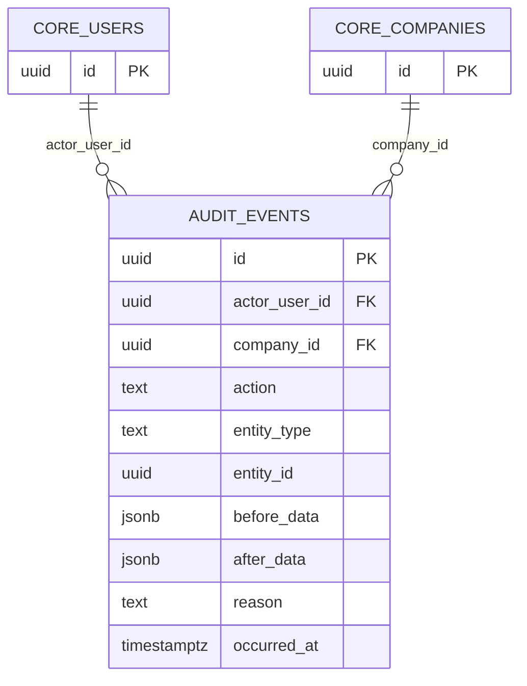
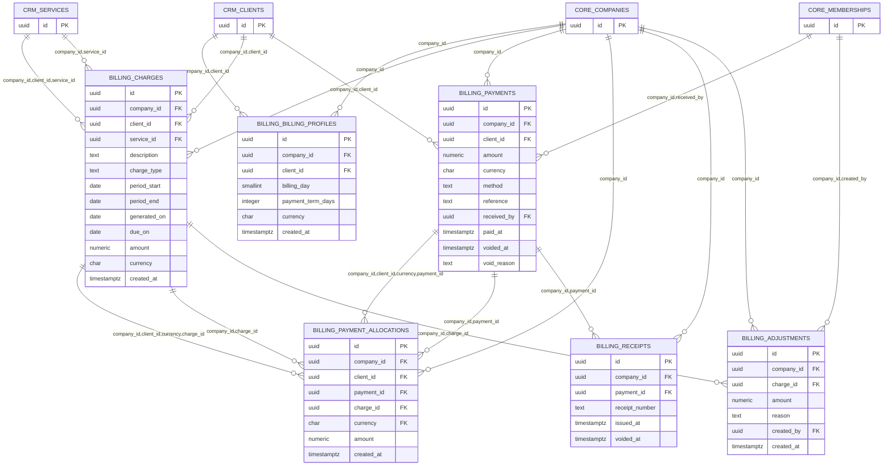
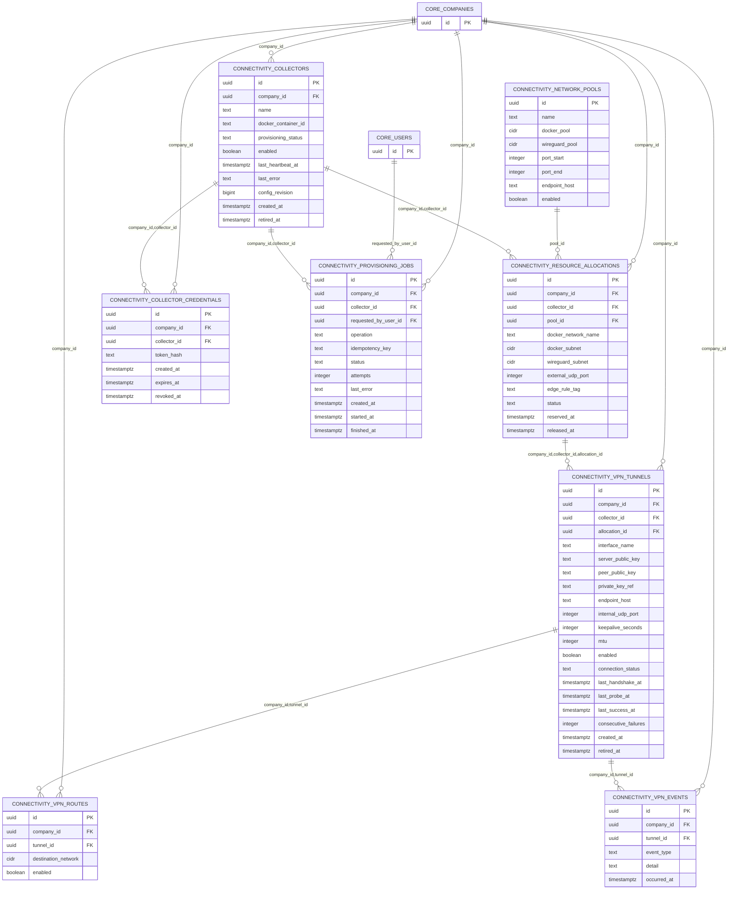
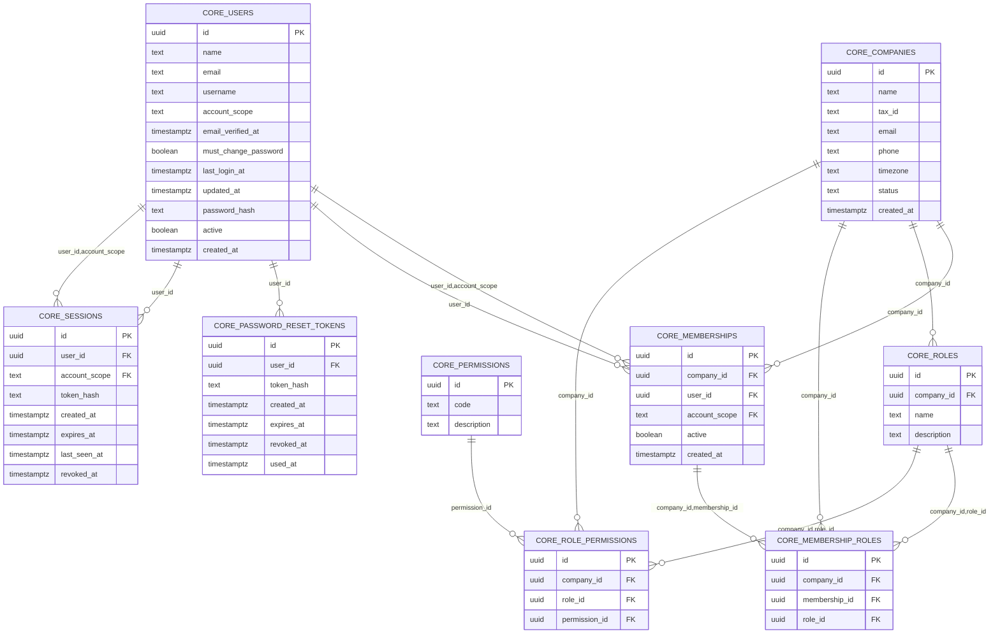
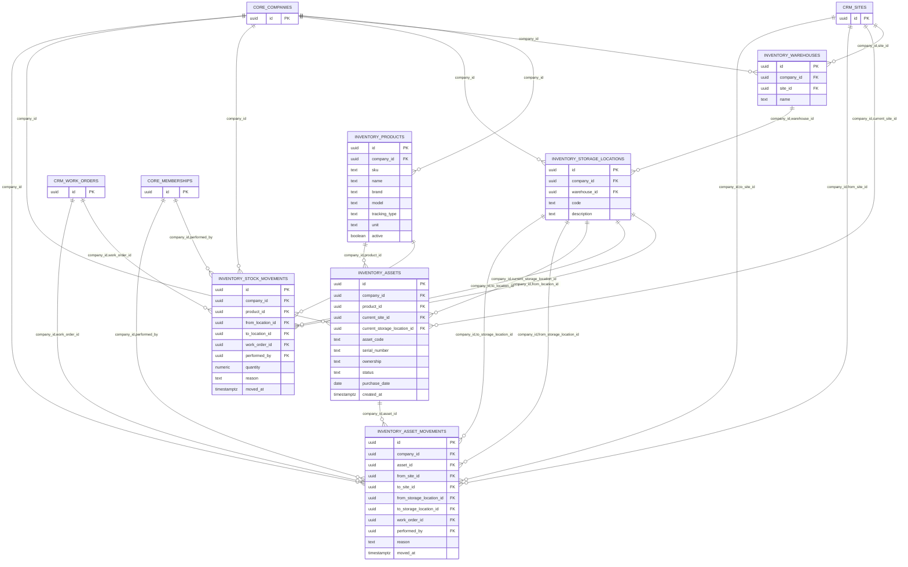
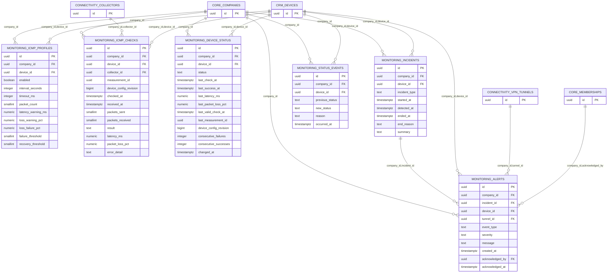
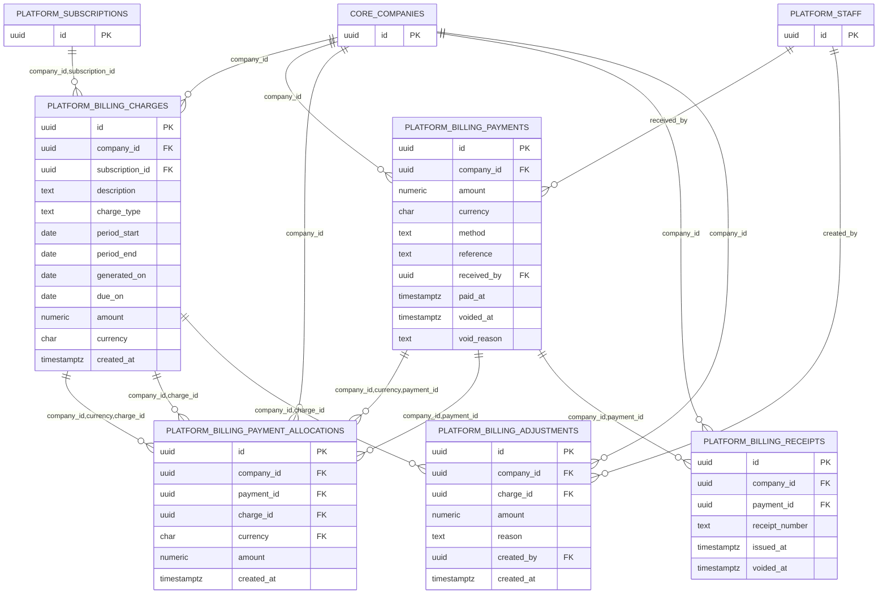

# SKNet — diagramas por schema

Modelo consolidado. Relaciones de referencia simplificadas; cardinalidades opcionales y restricciones únicas/compuestas se consultan en schema.sql. Entidades de otros schemas se muestran solo como referencias.

## audit

## billing

## connectivity

## core

## crm

```mermaid
erDiagram
    CORE_COMPANIES ||--o{ CRM_CLIENTS : "company_id"
    CORE_COMPANIES ||--o{ CRM_CLIENT_CONTACTS : "company_id"
    CRM_CLIENTS ||--o{ CRM_CLIENT_CONTACTS : "company_id,client_id"
    CORE_COMPANIES ||--o{ CRM_SITES : "company_id"
    CRM_CLIENTS ||--o{ CRM_SITES : "company_id,client_id"
    CORE_COMPANIES ||--o{ CRM_CLIENT_ADDRESSES : "company_id"
    CRM_CLIENTS ||--o{ CRM_CLIENT_ADDRESSES : "company_id,client_id"
    CORE_COMPANIES ||--o{ CRM_SERVICE_PLANS : "company_id"
    CORE_COMPANIES ||--o{ CRM_SERVICES : "company_id"
    CRM_SITES ||--o{ CRM_SERVICES : "company_id,client_id,site_id"
    CRM_CLIENTS ||--o{ CRM_SERVICES : "company_id,client_id"
    CRM_SITES ||--o{ CRM_SERVICES : "company_id,site_id"
    CRM_SERVICE_PLANS ||--o{ CRM_SERVICES : "company_id,plan_id"
    CORE_COMPANIES ||--o{ CRM_SERVICE_STATUS_HISTORY : "company_id"
    CRM_SERVICES ||--o{ CRM_SERVICE_STATUS_HISTORY : "company_id,service_id"
    CORE_MEMBERSHIPS ||--o{ CRM_SERVICE_STATUS_HISTORY : "company_id,changed_by"
    CORE_COMPANIES ||--o{ CRM_DOCUMENTS : "company_id"
    CRM_CLIENTS ||--o{ CRM_DOCUMENTS : "company_id,client_id"
    CORE_MEMBERSHIPS ||--o{ CRM_DOCUMENTS : "company_id,uploaded_by"
    CORE_COMPANIES ||--o{ CRM_CONTRACTS : "company_id"
    CRM_SERVICES ||--o{ CRM_CONTRACTS : "company_id,client_id,service_id"
    CRM_DOCUMENTS ||--o{ CRM_CONTRACTS : "company_id,client_id,document_id"
    CRM_CLIENTS ||--o{ CRM_CONTRACTS : "company_id,client_id"
    CRM_SERVICES ||--o{ CRM_CONTRACTS : "company_id,service_id"
    CRM_DOCUMENTS ||--o{ CRM_CONTRACTS : "company_id,document_id"
    CORE_COMPANIES ||--o{ CRM_CLIENT_NOTES : "company_id"
    CRM_CLIENTS ||--o{ CRM_CLIENT_NOTES : "company_id,client_id"
    CORE_MEMBERSHIPS ||--o{ CRM_CLIENT_NOTES : "company_id,author_id"
    CORE_COMPANIES ||--o{ CRM_TAGS : "company_id"
    CORE_COMPANIES ||--o{ CRM_CLIENT_TAGS : "company_id"
    CRM_CLIENTS ||--o{ CRM_CLIENT_TAGS : "company_id,client_id"
    CRM_TAGS ||--o{ CRM_CLIENT_TAGS : "company_id,tag_id"
    CORE_COMPANIES ||--o{ CRM_TICKETS : "company_id"
    CRM_SERVICES ||--o{ CRM_TICKETS : "company_id,client_id,service_id"
    CRM_CLIENTS ||--o{ CRM_TICKETS : "company_id,client_id"
    CRM_SERVICES ||--o{ CRM_TICKETS : "company_id,service_id"
    CORE_MEMBERSHIPS ||--o{ CRM_TICKETS : "company_id,created_by"
    CORE_MEMBERSHIPS ||--o{ CRM_TICKETS : "company_id,assigned_to"
    CORE_COMPANIES ||--o{ CRM_TICKET_COMMENTS : "company_id"
    CRM_TICKETS ||--o{ CRM_TICKET_COMMENTS : "company_id,ticket_id"
    CORE_MEMBERSHIPS ||--o{ CRM_TICKET_COMMENTS : "company_id,author_id"
    CORE_COMPANIES ||--o{ CRM_TICKET_STATUS_HISTORY : "company_id"
    CRM_TICKETS ||--o{ CRM_TICKET_STATUS_HISTORY : "company_id,ticket_id"
    CORE_MEMBERSHIPS ||--o{ CRM_TICKET_STATUS_HISTORY : "company_id,changed_by"
    CORE_COMPANIES ||--o{ CRM_WORK_ORDERS : "company_id"
    CRM_TICKETS ||--o{ CRM_WORK_ORDERS : "company_id,ticket_id"
    CORE_COMPANIES ||--o{ CRM_WORK_ORDER_ASSIGNMENTS : "company_id"
    CRM_WORK_ORDERS ||--o{ CRM_WORK_ORDER_ASSIGNMENTS : "company_id,work_order_id"
    CORE_MEMBERSHIPS ||--o{ CRM_WORK_ORDER_ASSIGNMENTS : "company_id,membership_id"
    CORE_COMPANIES ||--o{ CRM_WORK_ORDER_HISTORY : "company_id"
    CRM_WORK_ORDERS ||--o{ CRM_WORK_ORDER_HISTORY : "company_id,work_order_id"
    CORE_MEMBERSHIPS ||--o{ CRM_WORK_ORDER_HISTORY : "company_id,changed_by"
    CORE_COMPANIES ||--o{ CRM_TASKS : "company_id"
    CRM_CLIENTS ||--o{ CRM_TASKS : "company_id,client_id"
    CORE_MEMBERSHIPS ||--o{ CRM_TASKS : "company_id,assigned_to"
    CORE_COMPANIES ||--o{ CRM_ACTIVITIES : "company_id"
    CRM_CLIENTS ||--o{ CRM_ACTIVITIES : "company_id,client_id"
    CORE_MEMBERSHIPS ||--o{ CRM_ACTIVITIES : "company_id,created_by"
    CORE_COMPANIES ||--o{ CRM_DEVICES : "company_id"
    CONNECTIVITY_COLLECTORS ||--o{ CRM_DEVICES : "company_id,collector_id"
    CRM_SERVICES ||--o{ CRM_DEVICES : "company_id,site_id,service_id"
    CRM_SERVICES ||--o{ CRM_DEVICES : "company_id,service_id"
    CRM_SITES ||--o{ CRM_DEVICES : "company_id,site_id"
    INVENTORY_ASSETS ||--o{ CRM_DEVICES : "company_id,asset_id"
    CRM_DEVICES ||--o{ CRM_SERVICES : "company_id,access_router_id"
    CONNECTIVITY_COLLECTORS {
        uuid id PK
    }
    CORE_COMPANIES {
        uuid id PK
    }
    CORE_MEMBERSHIPS {
        uuid id PK
    }
    CRM_ACTIVITIES {
        uuid id PK
        uuid company_id FK
        uuid client_id FK
        uuid created_by FK
        text activity_type
        text subject
        text description
        timestamptz activity_at
    }
    CRM_CLIENT_ADDRESSES {
        uuid id PK
        uuid company_id FK
        uuid client_id FK
        text address
        text city
        text address_type
    }
    CRM_CLIENT_CONTACTS {
        uuid id PK
        uuid company_id FK
        uuid client_id FK
        text name
        text position
        text email
        text phone
        boolean is_primary
    }
    CRM_CLIENT_NOTES {
        uuid id PK
        uuid company_id FK
        uuid client_id FK
        uuid author_id FK
        text body
        timestamptz created_at
    }
    CRM_CLIENT_TAGS {
        uuid id PK
        uuid company_id FK
        uuid client_id FK
        uuid tag_id FK
    }
    CRM_CLIENTS {
        uuid id PK
        uuid company_id FK
        text client_code
        text client_type
        text name
        text document_type
        text document_number
        text email
        text phone
        text status
        timestamptz created_at
    }
    CRM_CONTRACTS {
        uuid id PK
        uuid company_id FK
        uuid client_id FK
        uuid service_id FK
        uuid document_id FK
        text contract_number
        date start_date
        date end_date
        text status
    }
    CRM_DEVICES {
        uuid id PK
        uuid company_id FK
        uuid service_id FK
        uuid site_id FK
        uuid asset_id FK
        text name
        text device_type
        text device_role
        uuid collector_id FK
        bigint config_revision
        text brand
        text model
        text serial_number
        macaddr mac_address
        inet ip_address
        boolean monitoring_enabled
        timestamptz installed_at
        timestamptz retired_at
        timestamptz created_at
    }
    CRM_DOCUMENTS {
        uuid id PK
        uuid company_id FK
        uuid client_id FK
        uuid uploaded_by FK
        text file_name
        text storage_key
        text mime_type
        timestamptz created_at
    }
    CRM_SERVICE_PLANS {
        uuid id PK
        uuid company_id FK
        text name
        text service_type
        numeric monthly_price
        integer download_mbps
        integer upload_mbps
        boolean active
        timestamptz created_at
    }
    CRM_SERVICE_STATUS_HISTORY {
        uuid id PK
        uuid company_id FK
        uuid service_id FK
        uuid changed_by FK
        text previous_status
        text new_status
        text reason
        timestamptz changed_at
    }
    CRM_SERVICES {
        uuid id PK
        uuid company_id FK
        uuid client_id FK
        uuid site_id FK
        uuid plan_id FK
        numeric monthly_price
        text access_method
        text ip_assignment
        text pppoe_username
        inet service_ip
        timestamptz service_ip_observed_at
        macaddr access_mac
        uuid access_router_id FK
        text technical_notes
        text status
        timestamptz activated_at
        timestamptz cancelled_at
        timestamptz created_at
    }
    CRM_SITES {
        uuid id PK
        uuid company_id FK
        uuid client_id FK
        text name
        text site_type
        text address
        text city
        numeric latitude
        numeric longitude
        boolean active
        timestamptz created_at
    }
    CRM_TAGS {
        uuid id PK
        uuid company_id FK
        text name
    }
    CRM_TASKS {
        uuid id PK
        uuid company_id FK
        uuid client_id FK
        uuid assigned_to FK
        text title
        text description
        text status
        timestamptz due_at
        timestamptz created_at
    }
    CRM_TICKET_COMMENTS {
        uuid id PK
        uuid company_id FK
        uuid ticket_id FK
        uuid author_id FK
        text body
        boolean internal
        timestamptz created_at
    }
    CRM_TICKET_STATUS_HISTORY {
        uuid id PK
        uuid company_id FK
        uuid ticket_id FK
        uuid changed_by FK
        text previous_status
        text new_status
        text reason
        timestamptz changed_at
    }
    CRM_TICKETS {
        uuid id PK
        uuid company_id FK
        uuid client_id FK
        uuid service_id FK
        uuid created_by FK
        uuid assigned_to FK
        text ticket_number
        text subject
        text description
        text priority
        text status
        text resolution
        text closure_reason
        timestamptz opened_at
        timestamptz resolved_at
        timestamptz closed_at
    }
    CRM_WORK_ORDER_ASSIGNMENTS {
        uuid id PK
        uuid company_id FK
        uuid work_order_id FK
        uuid membership_id FK
        timestamptz assigned_at
    }
    CRM_WORK_ORDER_HISTORY {
        uuid id PK
        uuid company_id FK
        uuid work_order_id FK
        uuid changed_by FK
        text previous_status
        text new_status
        text reason
        timestamptz changed_at
    }
    CRM_WORK_ORDERS {
        uuid id PK
        uuid company_id FK
        uuid ticket_id FK
        text order_number
        text title
        text description
        text status
        timestamptz scheduled_at
        timestamptz completed_at
        text result
        timestamptz created_at
    }
    INVENTORY_ASSETS {
        uuid id PK
    }
```

## inventory

## monitoring

## platform

```mermaid
erDiagram
    CORE_USERS ||--o{ PLATFORM_STAFF : "user_id,account_scope"
    CORE_USERS ||--o{ PLATFORM_STAFF : "user_id"
    PLATFORM_STAFF ||--o{ PLATFORM_STAFF_ROLES : "staff_id"
    PLATFORM_ROLES ||--o{ PLATFORM_STAFF_ROLES : "role_id"
    PLATFORM_ROLES ||--o{ PLATFORM_ROLE_PERMISSIONS : "role_id"
    PLATFORM_PERMISSIONS ||--o{ PLATFORM_ROLE_PERMISSIONS : "permission_id"
    PLATFORM_PLANS ||--o{ PLATFORM_PLAN_VERSIONS : "plan_id"
    PLATFORM_PLAN_VERSIONS ||--o{ PLATFORM_PLAN_FEATURES : "plan_version_id"
    PLATFORM_FEATURES ||--o{ PLATFORM_PLAN_FEATURES : "feature_id"
    PLATFORM_PLAN_VERSIONS ||--o{ PLATFORM_SETTINGS : "default_plan_version_id"
    CORE_COMPANIES ||--o{ PLATFORM_SUBSCRIPTIONS : "company_id"
    PLATFORM_PLAN_VERSIONS ||--o{ PLATFORM_SUBSCRIPTIONS : "plan_version_id"
    CORE_COMPANIES ||--o{ PLATFORM_SUBSCRIPTION_HISTORY : "company_id"
    PLATFORM_SUBSCRIPTIONS ||--o{ PLATFORM_SUBSCRIPTION_HISTORY : "company_id,subscription_id"
    CORE_USERS ||--o{ PLATFORM_SUBSCRIPTION_HISTORY : "changed_by"
    PLATFORM_PLAN_VERSIONS ||--o{ PLATFORM_SUBSCRIPTION_HISTORY : "previous_plan_version_id"
    PLATFORM_PLAN_VERSIONS ||--o{ PLATFORM_SUBSCRIPTION_HISTORY : "new_plan_version_id"
    CORE_COMPANIES ||--o{ PLATFORM_SUPPORT_TICKETS : "company_id"
    CORE_MEMBERSHIPS ||--o{ PLATFORM_SUPPORT_TICKETS : "company_id,requested_by"
    PLATFORM_STAFF ||--o{ PLATFORM_SUPPORT_TICKETS : "assigned_staff_id"
    CORE_COMPANIES ||--o{ PLATFORM_SUPPORT_TICKET_COMMENTS : "company_id"
    PLATFORM_SUPPORT_TICKETS ||--o{ PLATFORM_SUPPORT_TICKET_COMMENTS : "company_id,ticket_id"
    CORE_USERS ||--o{ PLATFORM_SUPPORT_TICKET_COMMENTS : "author_user_id"
    CORE_COMPANIES ||--o{ PLATFORM_SUPPORT_TICKET_HISTORY : "company_id"
    PLATFORM_SUPPORT_TICKETS ||--o{ PLATFORM_SUPPORT_TICKET_HISTORY : "company_id,ticket_id"
    CORE_USERS ||--o{ PLATFORM_SUPPORT_TICKET_HISTORY : "changed_by"
    CORE_COMPANIES ||--o{ PLATFORM_SUPPORT_ACCESS_LOGS : "company_id"
    PLATFORM_STAFF ||--o{ PLATFORM_SUPPORT_ACCESS_LOGS : "staff_id"
    CORE_COMPANIES {
        uuid id PK
    }
    CORE_MEMBERSHIPS {
        uuid id PK
    }
    CORE_USERS {
        uuid id PK
    }
    PLATFORM_FEATURES {
        uuid id PK
        text code
        text name
        boolean implemented
    }
    PLATFORM_PERMISSIONS {
        uuid id PK
        text code
        text description
    }
    PLATFORM_PLAN_FEATURES {
        uuid id PK
        uuid plan_version_id FK
        uuid feature_id FK
    }
    PLATFORM_PLAN_VERSIONS {
        uuid id PK
        uuid plan_id FK
        integer version
        numeric monthly_price
        char currency
        integer trial_days
        integer max_clients
        integer max_devices
        integer max_users
        integer min_poll_interval_seconds
        integer retention_days
        timestamptz effective_at
    }
    PLATFORM_PLANS {
        uuid id PK
        text code
        text name
        boolean active
        timestamptz created_at
    }
    PLATFORM_ROLE_PERMISSIONS {
        uuid id PK
        uuid role_id FK
        uuid permission_id FK
    }
    PLATFORM_ROLES {
        uuid id PK
        text name
        text description
    }
    PLATFORM_SETTINGS {
        boolean singleton PK
        boolean public_signup_enabled
        uuid default_plan_version_id FK
        timestamptz updated_at
    }
    PLATFORM_STAFF {
        uuid id PK
        uuid user_id FK
        text account_scope FK
        boolean active
    }
    PLATFORM_STAFF_ROLES {
        uuid id PK
        uuid staff_id FK
        uuid role_id FK
    }
    PLATFORM_SUBSCRIPTION_HISTORY {
        uuid id PK
        uuid company_id FK
        uuid subscription_id FK
        uuid changed_by FK
        text previous_status
        text new_status
        uuid previous_plan_version_id FK
        uuid new_plan_version_id FK
        text reason
        timestamptz changed_at
    }
    PLATFORM_SUBSCRIPTIONS {
        uuid id PK
        uuid company_id FK
        uuid plan_version_id FK
        text status
        timestamptz starts_at
        timestamptz ends_at
        smallint billing_day
        integer payment_term_days
    }
    PLATFORM_SUPPORT_ACCESS_LOGS {
        uuid id PK
        uuid company_id FK
        uuid staff_id FK
        text reason
        timestamptz started_at
        timestamptz expires_at
        timestamptz ended_at
    }
    PLATFORM_SUPPORT_TICKET_COMMENTS {
        uuid id PK
        uuid company_id FK
        uuid ticket_id FK
        uuid author_user_id FK
        text body
        boolean internal
        timestamptz created_at
    }
    PLATFORM_SUPPORT_TICKET_HISTORY {
        uuid id PK
        uuid company_id FK
        uuid ticket_id FK
        uuid changed_by FK
        text actor_type
        text previous_status
        text new_status
        text reason
        timestamptz changed_at
    }
    PLATFORM_SUPPORT_TICKETS {
        uuid id PK
        uuid company_id FK
        uuid requested_by FK
        text origin
        text fault_key
        uuid assigned_staff_id FK
        text subject
        text description
        text status
        text priority
        text closure_reason
        timestamptz opened_at
        timestamptz closed_at
    }
```

## platform_billing

